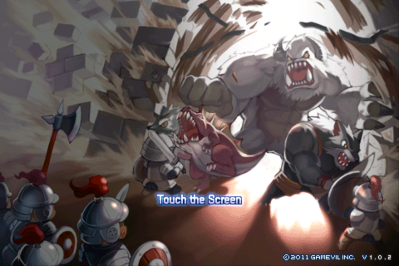
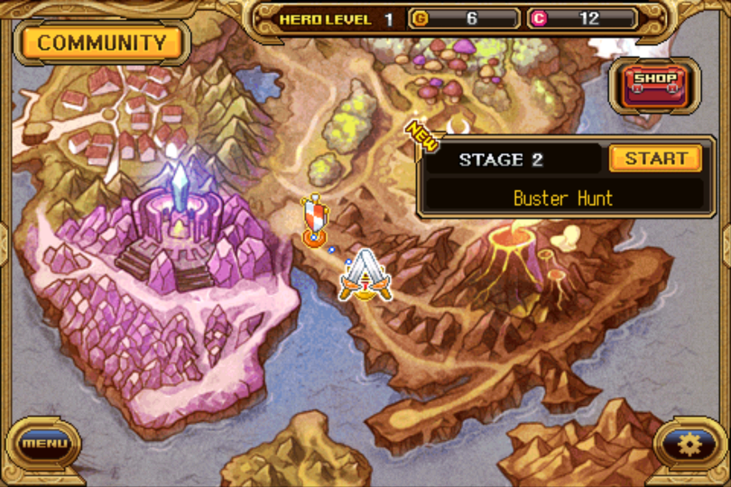
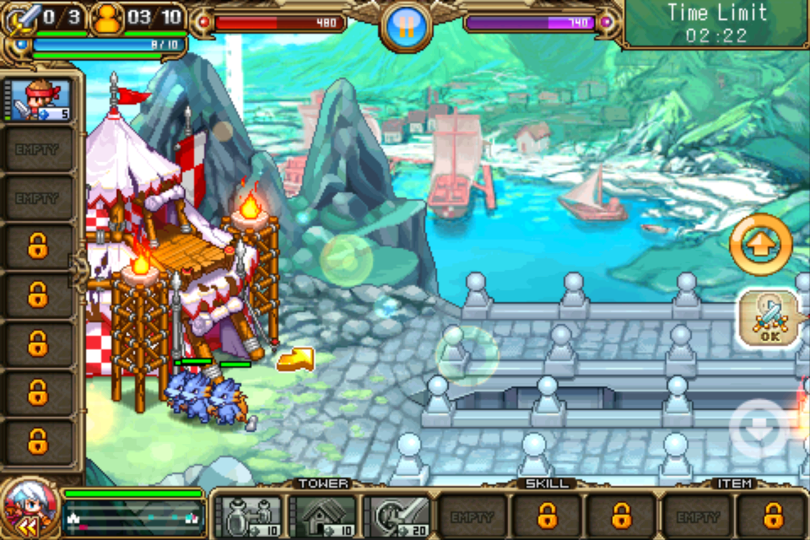
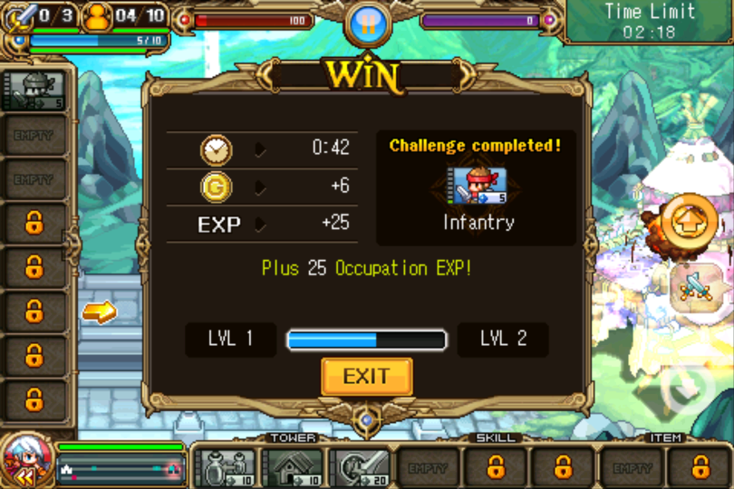
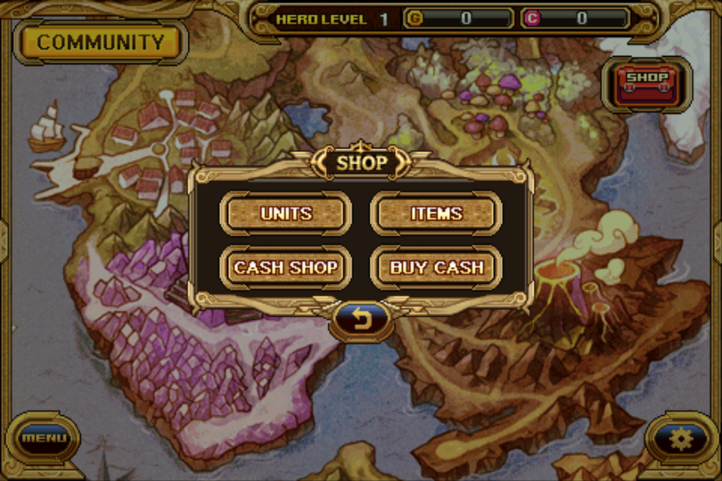
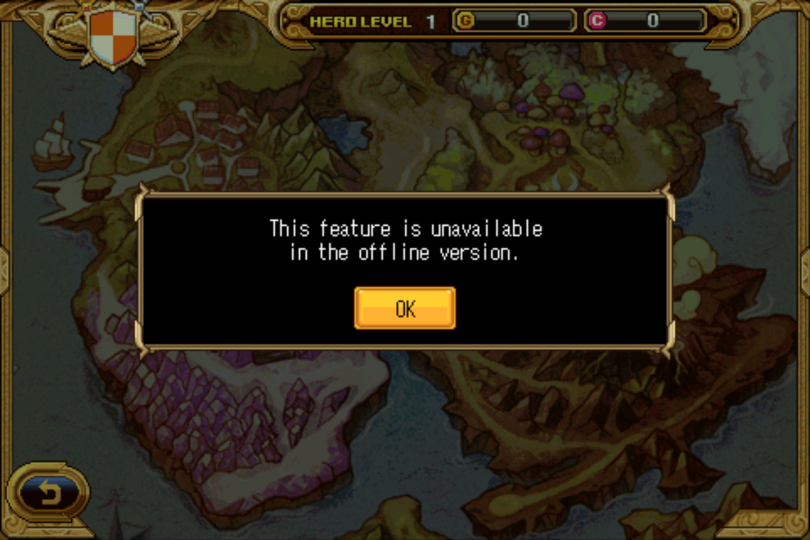

<h1 align="center">Arel Wars 1 — fan revival</h1>

<p align="center"><b>Gamevil's 2012 tower-war RPG, playable again on a modern Android phone.<br>Fully offline. No account, no server, no ads.</b></p>

<p align="center">
  <a href="../../releases/latest"></a>
  
  
</p>

<p align="center"></p>

Arel Wars (Android v1.0.2) stopped working years ago. Its servers are gone, it stops at a network check on every start, and Android 15 refuses to install it at all. This project patches the original APK so it installs and runs on current Android, with every online feature cleanly switched off and saves that survive updates.

**Download the ready-to-install APK from [Releases](../../releases/latest).** The source tree holds the build tooling, patch specs and test gates. It does not contain the game's code or assets.

---

<table>
  <tr>
    <td width="50%"></td>
    <td width="50%"></td>
  </tr>
  <tr>
    <td align="center"><sub>World map. The Cash counter is filled by stage wins</sub></td>
    <td align="center"><sub>Battle: summon units, send your hero, take the enemy tower</sub></td>
  </tr>
  <tr>
    <td width="50%"></td>
    <td width="50%"></td>
  </tr>
  <tr>
    <td align="center"><sub>Victory rewards</sub></td>
    <td align="center"><sub>Shop: spend Gold and earned Cash on units and items</sub></td>
  </tr>
</table>

<sub>Real screenshots from the release build on a Redmi Note 12, cropped to the game's 3:2 picture.</sub>

## What you get

- **The full single-player campaign:** story mode, battles, world map, heroes, units, shop.
- **No network at all.** The only permission requested is `VIBRATE`. Without `INTERNET`, Android blocks every connection the app could try. No analytics, ads, push messages or device identifiers.
- **Runs on Android 15** at target SDK 28, with no "built for an older version" warning.
- **Correct picture:** the game's own 3:2 shape with black side bars, instead of stretched 24% wide. Taps line up.
- **Saves you can keep:** they survive force-stop, relaunch and updates, and a copy is mirrored to a folder you can back up without root.
- **Cash is earnable offline.** In the original, Cash came from real-money purchases and PvP. Each stage win now also pays **2 Cash per Gold**, so the Cash-only heroes and items are within reach. See [Balance](#balance).
- **Clear messages where online features used to be.** PvP, mail, rankings, Export and Import show *"This feature is unavailable in the offline version."* Real-money purchases show *"Purchases are unavailable in this offline version."* Nothing freezes, exits, charges or touches your save.

## Status

Tested on a Redmi Note 12, Android 15 (HyperOS 2). Each phase passed an automated gate script, run on the phone.

| Phase | Result |
|---|---|
| 0 Tooling | One command rebuilds the APK from the original |
| 1 Static audit | Startup, saves, network, shop and threads understood |
| 2 Device baseline | Original's behaviour on Android 15 recorded |
| 3 Offline | Reaches the title with no network ability, zero traffic on Wi-Fi |
| 4 Modern target | Installs at target SDK 28 |
| 5 Stability | Battles run and survive lock, home, exit and relaunch |
| 6 Offline features and saves | Online menus fail cleanly, saves survive updates, backup and restore work |
| 7 Release QA | All gates pass on the release build, plus a random-input soak with no crash. **Full playthrough by the owner in progress** |

## Installing

You need `arelwars-release.apk` from [the latest release](../../releases/latest) and an Android phone that can still run **32-bit ARM apps**. The game's native library is 32-bit only. Some recent phones, such as the Pixel 7 and later, have dropped 32-bit support and cannot run it. Testing was on Android 15. Older versions should work, since the APK declares SDK 7 as its minimum, but they are untested.

**With a PC (adb):**

```
adb install -r arelwars-release.apk
```

**Without a PC:** copy the APK to the phone, open it from a file manager, and allow "install unknown apps" when asked. Android may show a review screen for older apps on first launch. Tap Continue.

To **update**, install the new APK over the old one the same way. **Never uninstall first.**

## Keeping your save

> [!WARNING]
> **Uninstalling the game, or "Clear data" in Android settings, deletes your save.** Always update by installing over the top.

- Updates only install over each other when they are signed with the same key. Check the certificate against [VERIFY.md](VERIFY.md). A build signed by anyone else, including the original Gamevil APK, can only be installed by uninstalling first, and that deletes your save.
- The game copies its save about a second after every save, and whenever you leave the game, to:
  ```
  /sdcard/Android/data/com.gamevil.eruelwars.global/files/saves/
  ```
  Copy that whole folder somewhere safe now and then, over USB or with `adb pull`. The files (`Save0.dat`, `Sng0.dat`, `option.sav`) only work as a set, so always keep them together.

## Not included



- **Online play of any kind:** PvP, revenge matches, mail, rankings, cloud Export and Import. By design.
- **Real-money purchases.** Cash comes from stage wins instead.
- Tested on **one phone** only. Other devices and Android versions may differ. Phones without 32-bit app support cannot run it.
- The navigation bar stays visible in the right-hand black bar.

<br clear="right">

## Balance

A full Normal playthrough pays about 87,000 Cash. Normal plus Hard pays about 247,000. Everything bought only with Cash adds up to about 173,000. So one Normal run buys a good share of it, and Hard as well buys everything. A loss pays nothing, as before. The rate is one constant (`scripts/lib/gen-cash.mjs`) and may change after more real play.

## How it is built

`scripts/build` takes the original APK (checked by SHA-256, see [VERIFY.md](VERIFY.md)) and applies patches in a fixed order:

1. Decodes the Java code with apktool and applies smali patches. The patches that contain decompiled game code as diff context are **not published**. `scripts/lib/gen-stubs.mjs` documents the network and identity stubs, and `patches/src/` holds this project's own Java.
2. Edits the binary manifest with `scripts/lib/axml.mjs`, using `patches/manifest/*.json`.
3. Byte-patches the native library with `patches/binary/*.json`. Each patch checks the expected original bytes before changing anything.
4. Replaces a few in-game strings with `scripts/lib/zt1text.mjs`.
5. Copies the original APK entry by entry (`scripts/Transplant.java`), replacing only the changed entries and keeping every storage method, so the audio stays intact.
6. Aligns and signs.

Because step 1 depends on unpublished patches, this repository alone does not rebuild the APK. It documents and verifies every change.

`scripts/gates/gate-N` holds the checks each phase had to pass. [CHANGES.md](CHANGES.md) lists every change to the game and why, in plain language. [CHANGELOG.md](CHANGELOG.md) lists changes per release.

## Not affiliated

Arel Wars is a trademark of its owner. This is an unofficial fan project, not affiliated with or endorsed by Gamevil or Com2uS. It is not sold, and it contains no in-app purchases.
