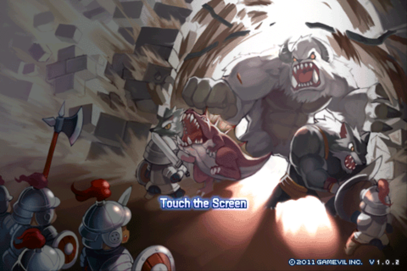
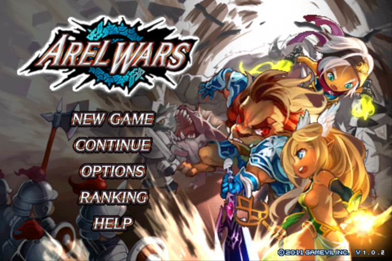
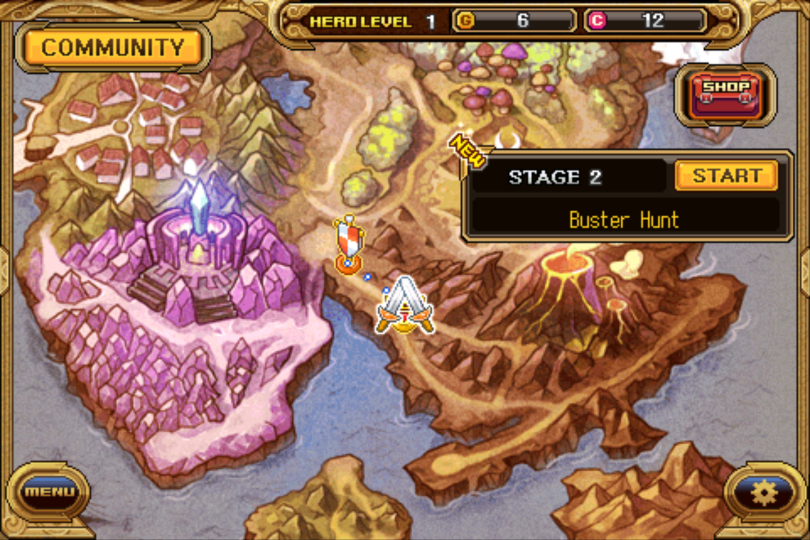
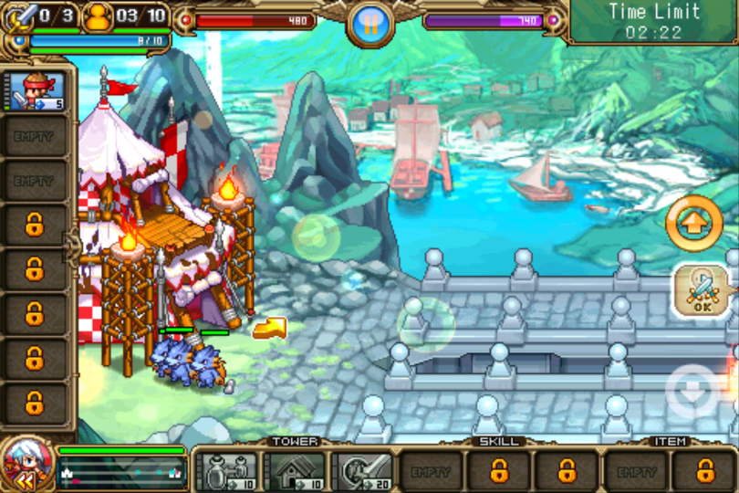
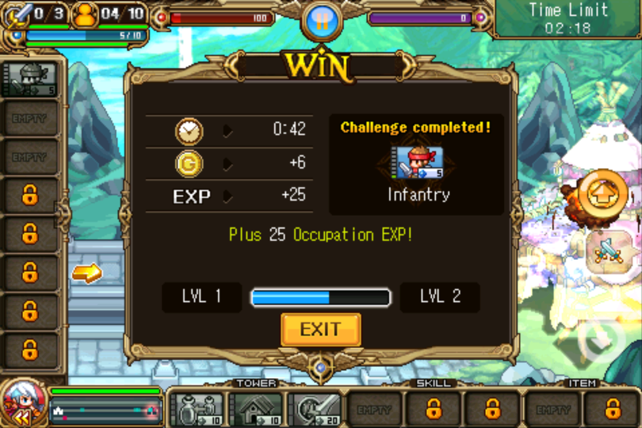
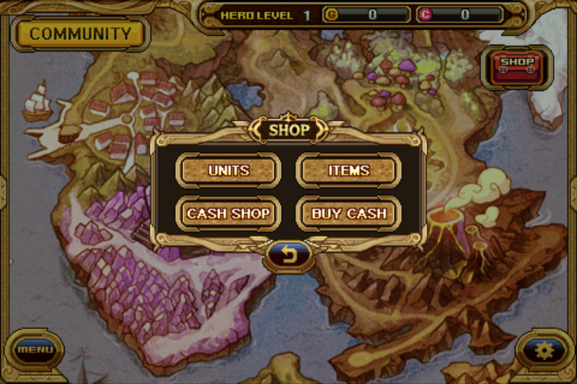
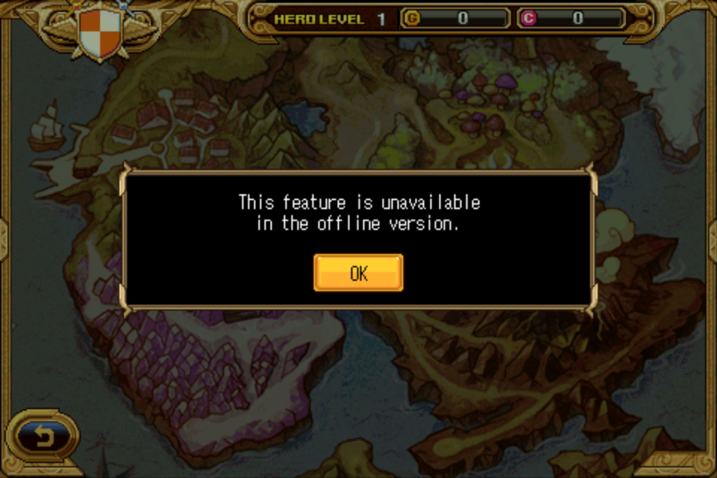

<h1 align="center">Arel Wars 1 — fan revival</h1>

<p align="center"><b>Gamevil's 2012 tower-war RPG, playable again on a modern Android phone.<br>Fully offline. No account, no server, no ads.</b></p>

<p align="center">
  <a href="https://github.com/z0orb/arel-wars-1-fan-revival/releases/latest"></a>
  
  
  
</p>

<table>
  <tr>
    <td width="50%"></td>
    <td width="50%"></td>
  </tr>
  <tr>
    <td align="center"><sub>Title screen</sub></td>
    <td align="center"><sub>Main menu, with the three heroes</sub></td>
  </tr>
</table>

Arel Wars (Android v1.0.2) stopped working years ago. Its servers are gone, it stops at a network check on every start, and Android 15 refuses to install it at all. This project patches the original APK so it installs and runs on current Android, with every online feature cleanly switched off and saves that survive updates.

**Version 2** also runs on phones with no 32-bit support. On those phones, a small ARM emulator inside the app runs the original game code. See [docs/INSTALL-v2.md](docs/INSTALL-v2.md).

**Download the ready-to-install APK from [Releases](https://github.com/z0orb/arel-wars-1-fan-revival/releases/latest).** The source tree holds the build tooling, patch specs and test gates. It does not contain the game's code or assets.

---

<table>
  <tr>
    <td width="50%"></td>
    <td width="50%"></td>
  </tr>
  <tr>
    <td align="center"><sub>World map. The Cash counter is filled by stage wins</sub></td>
    <td align="center"><sub>Battle: summon units, send your hero, take the enemy tower</sub></td>
  </tr>
  <tr>
    <td width="50%"></td>
    <td width="50%"></td>
  </tr>
  <tr>
    <td align="center"><sub>Victory rewards</sub></td>
    <td align="center"><sub>Shop: spend Gold and earned Cash on units and items</sub></td>
  </tr>
</table>

<sub>Real screenshots from the release build on a Redmi Note 12, cropped to the game's 3:2 picture.</sub>

## What you get

- **The full single-player campaign:** story mode, battles, world map, heroes, units, shop.
- **No network at all.** The only permission requested is `VIBRATE`. Without `INTERNET`, Android blocks every connection the app could try. No analytics, ads, push messages or device identifiers.
- **Runs on Android 5.0 to Android 16**, on 32-bit and 64-bit phones. Version 2 targets SDK 35, with no "built for an older version" warning.
- **Correct picture:** the game's own 3:2 shape with black side bars, instead of stretched 24% wide. Taps line up.
- **Saves you can keep:** they survive force-stop, relaunch and updates, and a copy is mirrored to a folder you can back up without root.
- **Cash is earnable offline.** In the original, Cash came from real-money purchases and PvP. Each stage win now also pays **2 Cash per Gold**, so the Cash-only heroes and items are within reach. See [Balance](#balance).
- **Clear messages where online features used to be.** PvP, mail, rankings, Export and Import show *"This feature is unavailable in the offline version."* Real-money purchases show *"Purchases are unavailable in this offline version."* Nothing freezes, exits, charges or touches your save.

## Installing

Get `arelwars-v2.0.0.apk` from [the latest release](https://github.com/z0orb/arel-wars-1-fan-revival/releases/latest). It needs Android 5.0 or later. It runs on 64-bit phones with no 32-bit support, for example the Pixel 7 and later.

**With a PC (adb):**

```
adb install -r arelwars-v2.0.0.apk
```

**Without a PC:** copy the APK to the phone, open it from a file manager, and allow "Install unknown apps" when Android asks. If Play Protect shows "Unsafe app blocked", tap "More details", then "Install anyway".

In Brazil, Indonesia, Singapore and Thailand, Android blocks apps from unverified developers. There, use adb or the "advanced flow" of Android. [docs/INSTALL-v2.md](docs/INSTALL-v2.md) has each step, the Xiaomi (HyperOS) items and the save import.

Version 2 has its own package (`io.github.z0orb.arelwars`). It installs next to v1 and does not touch the v1 save. To update v2, install the new APK over the old one. **Never uninstall first.**

The v1 APK (`arelwars-release.apk`) is still available in [release v1.0.0](https://github.com/z0orb/arel-wars-1-fan-revival/releases/tag/v1.0.0). It needs a phone that runs 32-bit ARM apps.

## Keeping your save

> [!WARNING]
> **Uninstalling the game, or "Clear data" in Android settings, deletes your save.** Always update by installing over the top.

- **From v1 to v2:** copy the v1 save folder to a normal folder, then open "Arel Wars Save Import" and pick that folder. The import checks each file first. On Xiaomi phones, close the "Passed security tests" page of the installer before you start the import. Keep v1 until your save works in v2. [docs/INSTALL-v2.md](docs/INSTALL-v2.md#move-your-save-from-v1) has the steps.
- The game copies its save about a second after every save, and whenever you leave the game. v2 copies it to:
  ```
  /sdcard/Android/data/io.github.z0orb.arelwars/files/saves/
  ```
  v1 copies it to `/sdcard/Android/data/com.gamevil.eruelwars.global/files/saves/`. Copy that whole folder somewhere safe now and then, over USB or with `adb pull`. The files (`Save0.dat`, `Sng0.dat`, `option.sav`) only work as a set, so always keep them together.
- Updates only install over each other when the same key signs them. Check the certificate against [`VERIFY.md`](VERIFY.md).

## Compatibility

Version 2 passed the automated smoke test on each device below: install, start, title, world map, a battle, lock and unlock, and the save. The emulator rows are Android Emulator images (AOSP `default` unless the row says another image).

| Device | ABI | Result |
|---|---|---|
| Redmi Note 12, Android 15, HyperOS 2 | `arm64-v8a` (emulator) | Pass |
| Redmi Note 12, `adb install --abi armeabi-v7a` | `armeabi-v7a` (no emulator) | Pass |
| Emulator, Android 5.0 (API 21), phone, resize | `x86_64` | Pass, with no lock test (the emulator image freezes at a lock, also with no app) |
| Emulator, Android 6.0 (API 23), phone | `x86_64` | Pass |
| Emulator, Android 8.0 (API 26), phone | `x86_64` | Pass |
| Emulator, Android 9 (API 28), phone | `x86_64` | Pass |
| Emulator, Android 11 (API 30), phone | `x86_64` | Pass |
| Emulator, Android 13 (API 33), phone | `x86_64` | Pass |
| Emulator, Android 14 (API 34), phone | `x86_64` | Pass |
| Emulator, Android 15 (API 35), phone, resize | `x86_64` | Pass |
| Emulator, Android 16 (API 36), phone | `x86_64` | Pass |
| Emulator, Android 15, 16 KB memory pages | `x86_64` | Pass |
| Emulator, Android 11, 32-bit `x86` with ARM translation | `armeabi-v7a` | Pass |
| Emulator, Android 15, small phone, resize | `x86_64` | Pass |
| Emulator, Android 15, tablet, resize and multi-window | `x86_64` | Pass |
| Emulator, Android 15, foldable, resize | `x86_64` | Pass |
| 32-bit `x86` with no ARM translation | none | Does not install (`INSTALL_FAILED_NO_MATCHING_ABIS`) |

Speed on the Redmi Note 12, in the largest battle of the test: 21.2 frames each second with the emulator and with no emulator. The original game runs at about 21.3.

## Status

| Phase | Result |
|---|---|
| v1 phases 0 to 7 | Offline build at target SDK 28 for 32-bit phones (release v1.0.0) |
| v2 E0 | The emulator runs the game code on a 64-bit phone |
| v2 E1 to E3 | The bridge reaches the title, then full play, sound, input and saves |
| v2 E4 | Native ports of the drawing functions, pixel-exact against the original |
| v2 E5 | Target SDK 35, lock, back, offline and soak tests on the phone |
| v2 E6 | Compatibility matrix (table above) |
| v2 E7 | Speed bench: full speed in the largest battle |
| v2 E8 | Release v2.0.0 (2026-11-18). A real v1 save moved to v2 byte for byte |

## Not included



- **Online play of any kind:** PvP, revenge matches, mail, rankings, cloud Export and Import. By design.
- **Real-money purchases.** Cash comes from stage wins instead.
- Tested on **one real phone** and on Android emulators. Other phones can differ. Please report a phone that does not work.

<br clear="right">

## Balance

A full Normal playthrough pays about 87,000 Cash. Normal plus Hard pays about 247,000. Everything bought only with Cash adds up to about 173,000. So one Normal run buys a good share of it, and Hard as well buys everything. A loss pays nothing, as before. The rate is one constant (`scripts/lib/gen-cash.mjs`) and may change after more real play.

## How it is built

`scripts/build` takes the original APK (checked by SHA-256, see [VERIFY.md](VERIFY.md)) and applies patches in a fixed order:

1. Decodes the Java code with apktool and applies smali patches. The patches that contain decompiled game code as diff context are **not published**. `scripts/lib/gen-stubs.mjs` documents the network and identity stubs, and `patches/src/` holds this project's own Java.
2. Edits the binary manifest with `scripts/lib/axml.mjs`, using `patches/manifest/*.json`.
3. Byte-patches the native library with `patches/binary/*.json`. Each patch checks the expected original bytes before changing anything.
4. Replaces a few in-game strings with `scripts/lib/zt1text.mjs`.
5. Copies the original APK entry by entry (`scripts/Transplant.java`), replacing only the changed entries and keeping every storage method, so the audio stays intact.
6. Aligns and signs.

Because step 1 depends on unpublished patches, this repository alone does not rebuild the APK. It documents and verifies every change.

`scripts/gates/gate-N` holds the checks each phase had to pass. [CHANGES.md](CHANGES.md) lists every change to the game and why, in plain language. [CHANGELOG.md](CHANGELOG.md) lists changes per release.

**Version 2** has its build in `emu/`. `emu/scripts/build` does the v1 steps, then it adds the bridge library for `arm64-v8a` and `x86_64`, and the original library for `armeabi-v7a`. The bridge source is in `emu/bridge/src/`. The app Java code is in `emu/shell/src/`. The test gates are in `emu/scripts/gates/`. The build gets the emulator source (dynarmic and its parts) as archives, and checks each archive by SHA-256 (`emu/third_party/archives.sha256`). `emu/docs/NOTICE.md` has their licenses. As for v1, the smali patches are not published, so this repository alone does not rebuild the APK.

## Not affiliated

Arel Wars is a trademark of its owner. This is an unofficial fan project, not affiliated with or endorsed by Gamevil or Com2uS. It is not sold, and it contains no in-app purchases.

## Credit and license

Arel Wars was created by **Gamevil**. Nothing in the original game was made by this project. Its only part is bringing the game back to a playable state on modern Android. The project's own code is under the MIT License, and the game itself is not. See [LICENSE.md](LICENSE.md).
